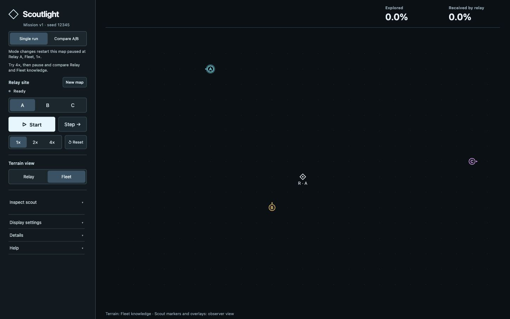
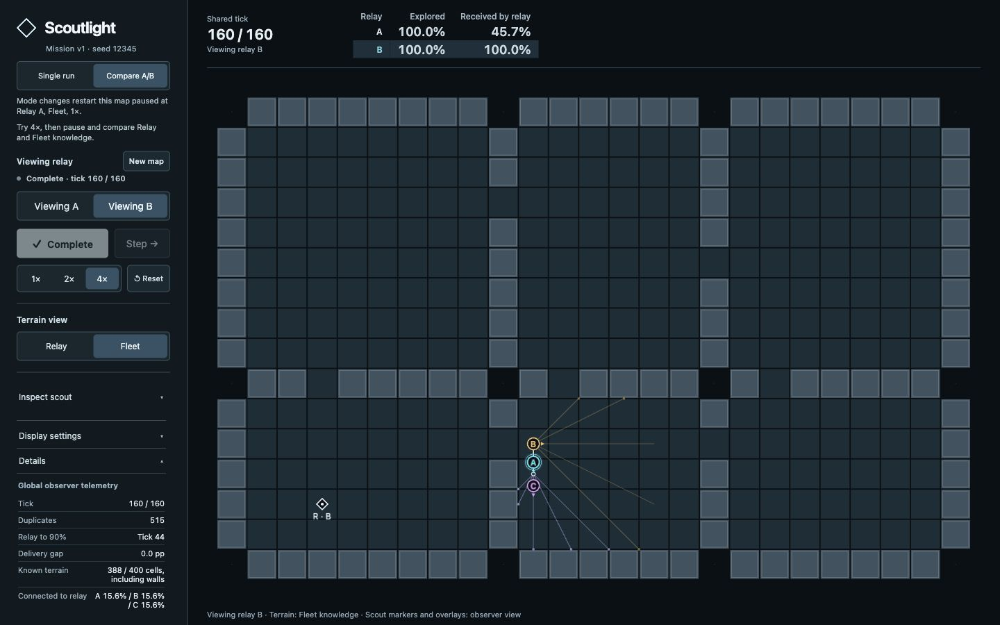
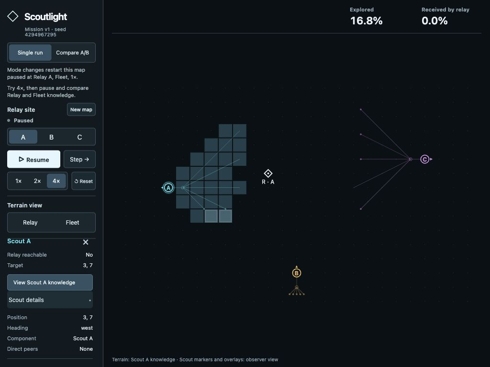

# Scoutlight

Explore an unknown grid with three autonomous scouts, choose a communication
relay site, and inspect what each scout and the relay know. **Single run** offers
relay sites A/B/C; **Compare A/B** shows two isolated runs at the same tick.
Save a mission URL to reproduce its map, scout starts, headings, and relay sites.
This is a browser simulation with one deterministic exploration policy.

[Live demo](https://marsigloo.github.io/scoutlight/) · [Source repository](https://github.com/MarsIgloo/scoutlight)

## Run locally

Use Node 22.12+ within Node 22, Node 24, or Node 26+ (verified on 26.0.0).
Dependencies are pinned in `package-lock.json`.

```sh
npm ci
npm run dev
```

Open the address printed by Vite, normally `http://127.0.0.1:5173/`.
For the production build:

```sh
npm run build
npm run preview
```

The local build opens at `http://127.0.0.1:4173/scoutlight/` (use the printed port). Everything runs in
the browser; no account, backend, or API key is needed. Development keeps its
root path; production build and preview use the `/scoutlight/` project path.

## Try a mission

The first visit opens **seed 12345, version 1**, paused at tick zero, Relay A,
Fleet knowledge, and 1×. Try **4× → Start**, then pause and switch **Relay/Fleet**
to compare explored terrain with information received by the relay. The Field
View keeps the map dominant; secondary controls start collapsed.

| Control | Behavior |
| --- | --- |
| Single run / Compare A/B | Keeps the mission but loads a fresh paused run: Relay A, Fleet, 1×, collapsed controls. |
| Relay A/B/C (single run) | Changes only the relay site and restarts the run. |
| Viewing A/B (comparison) | Changes presentation only; both runs remain at the shared tick. |
| Start/Pause, Step, 1×/2×/4× | Runs or steps the same policy; speed changes pacing. Runs stop at tick 160. |
| New map | Loads a different seed, preserving single/comparison mode, with fresh initial settings. |
| Reset | Replays the same mission and site (both sites in comparison); keeps speed and presentation settings. |
| Relay / Fleet | Draws received relay knowledge or the observer's union of scout knowledge. |
| Inspect scout | Opens A/B/C selection and a scout summary; offers that scout's own knowledge view. |

Clicking a scout also opens inspection. **Scout details** expands position,
heading, peers, sensing, and movement records. Closing scout knowledge restores
the last Relay/Fleet view. **Details** expands exact tick and metrics;
**Display settings** holds trails, rays, and links; **Help** holds the legend.
Expanded information scrolls inside the rail. Markers and overlays are observer
telemetry, not extra terrain knowledge available to the planner. Coverage metrics
remain Fleet exploration and relay receipt across terrain views.

Space toggles playback, Right Arrow steps while paused, and 1/2/4 select speed.
Shortcuts are guarded while a button or editable control has focus; focused
buttons retain their normal keyboard activation. Reset has no shortcut.

## Reproduce and compare

Development links below use `/`; production links use `/scoutlight/` with the
same query parameters:

- Single run: `/?seed=12345&v=1`
- Comparison: `/?seed=12345&v=1&compare=ab`

The address bar canonicalizes `/` to the default mission. `compare=ab` is the
only comparison encoding; absence means single run. Saved links and refresh
start paused at tick zero. Existing `preview=release` links are compatible
aliases and canonicalize to the same public seed/version/mode URL.

Seeds are canonical decimal integers from **0 through 4294967295**. A missing
seed on a public visit uses 12345 normally; a missing version uses v1. Invalid
supplied seeds or unsupported versions show an invalid-link fallback label
and canonicalize to seed 12345, v1. Refreshing that corrected URL reproduces
the fallback without another error. Published v1 outputs for seeds 0, 12345,
and 4294967295 are pinned by fixed terrain/start/heading/site references.

Development reviews remain available with `npm run dev`:
`/?review=missions&seed=12345&v=1` and `/?review=west-room`, optionally adding
`&compare=ab`. Mission-review New map preserves its development review URL.
West-room stays development-only; in production, review markers resolve to
public seeded missions. The original candidate remains a headless negative
control in `npm run experiment`.

## Evidence and checks

Run these sequentially:

```sh
npm run check
npm run build
npm run experiment
npm run investigate
npm run missions:sample
```

`check` combines strict TypeScript checking with tests of sensing, communication,
planning, immutable snapshots, full replay histories, timer lifecycle, paired
isolation, rendering information boundaries, keyboard guards, and mission URLs.
The experiments repeat complete states and metrics, not just final percentages.

At tick 160, seed 12345 reaches **100% explored** at every site. A receives
**45.71%** with **529** duplicate discoveries; B receives **100%** with **515**;
C receives **76.07%** with **529**. These are observations from a fixed mission.
The original candidate changes information delivery while its A/B/C movement
sequences remain identical. West-room demonstrates route sensitivity (Scout A
first moves west with A and north with B), not better exploration. Three
preselected seeds do not establish a generally superior relay.

Incremental-metrics repair (2026-10-20): strict types and **433 tests in 26 files**
passed in 76.28 seconds locally on Node 26.0.0. Build, experiment, investigation,
and the nine-run mission sample passed sequentially. The unchanged batch evaluator
checks accumulated metrics on every small-fixture prefix and selected large-run
prefixes. Existing complete-history, canonical-state/hash, timer, speed and cap
checks retain their assertions and 30-second budgets. Independent read-only review
found no blocking metric, immutable-publication or information-boundary defects
(correctness/readability 9/10). See [phase measurements](docs/metrics-performance.md)
for the same-environment before/after workload.

Pages publication verified (2026-10-20): [repair CI and deployment](https://github.com/MarsIgloo/scoutlight/actions/runs/39482623674)
passed **433 tests in 26 files** on Node 24.20.0 in 253.83 seconds, then built
and deployed. The slowest comparison-history case took 23.16 seconds, leaving
6.84 seconds under its unchanged budget. Live HTML and all seven referenced
assets returned 200; `build-info.json` matched repair commit `aa5ae43`.
The real HTTPS app passed fresh entry, saved-link refresh, comparison, mode
changes during playback, New map, Reset, Relay/Fleet/scout knowledge, inspection,
keyboard shortcuts and native focus/activation at 1440 × 900 and 1024 × 768.
Mode navigation after completion also started a fresh paused run. One hosted
4× paired seed-12345 run reached tick 160 with the headless results above:
100% explored in both, A displayed 45.7% received and 529 duplicates, B 100%
and 515. Completion was observed by 31.02 seconds; this is an observation bound,
not an exact completion timestamp. No application browser warnings or errors
were recorded. The existing reduced-motion and browser-coverage limits remain.

Default-promotion verification (2026-10-13): the inspected baseline passed
**415 tests in 26 files**; the final standard check passed **423 tests in 26
files**. Check, build, experiment, investigate, and the nine-run mission sample
passed sequentially. Engine, generator v1, fixed compatibility references,
runners, and replay/isolation assertions are unchanged. Earlier full-check
attempts encountered host sleep interruptions; the unchanged standard check
passed in 146.87 seconds once the Mac stayed awake. No timeout increase was used.
The production build retains the existing bundle-size warning.

The built app passed fresh/default and saved-link refresh, alias/fallback URLs,
mode changes during playback, New map, Reset, knowledge views, inspection,
keyboard activation/focus guards, and A/B switching at **1440 × 900** and
**1024 × 768**. Timed 4× paired seed-12345 runs completed tick 160 at both sizes
with the headless results above (A is displayed as 45.7%). Completion was
observed by 47.94 seconds at the larger size and 31.12 seconds at the smaller
size; these are observation bounds, not exact completion timestamps. No browser
warnings or errors were recorded. West-room's tick-one position difference and
the original candidate's identical physical routes remain unchanged.

Independent reviews scored functionality **9/10**, correctness/readability
**9/10**, interaction **8.8/10**, and visuals **8.7/10**, with no blocking replay,
information-boundary, history, or clock defects. The interaction/visual reviewer
used current screenshots, source, and recorded live browser flows; their own
browser connection was unavailable. No visual refinement was needed. Historical
reports remain verbatim in [verification history](docs/verification-history.md).

Read [the portfolio explanation](docs/portfolio.md) for architecture, policy,
tradeoffs, and limitations, or [the route investigation](docs/relay-route-investigation.md)
for the controlled route comparisons.

## Screenshots and limits

The hosted entry, completed comparison, and compact scout inspection (2026-10-20):





The desktop Field View is tested at 1440 × 900 and 1024 × 768;
smaller screens and other browser engines remain unverified. Reduced-motion
handling is implemented, but runtime preference emulation is unavailable in
the current browser tools. One rooms-and-passages generator and one policy are
implemented. Snapshot import is not schema-validated, and long-run performance
is untuned. This abstract simulation does not establish general relay superiority.
The install audit still reports one high-severity development-tool advisory in
transitive `source-map-js`; the lockfile was unchanged by this repair.

## Publishing updates

The Pages workflow in `.github/workflows/pages.yml` targets Node 24 LTS on an ARM macOS build runner, `npm ci`,
the full check with one worker, and the production build. Deployment depends on the successful
build job; only deployment receives Pages-write and identity-token permissions.
The site includes `build-info.json` with the deployed commit for verification.

For future updates, keep the Mac awake while running the checks above, review
`git diff`, commit the intended files, and push `main` to `origin`. Wait for
**Check and publish Pages** to succeed, then verify the live mission, refresh,
and comparison. Keep `/scoutlight/` as the production base for this repository.

Deployment follows the official [Vite Pages guide](https://vite.dev/guide/static-deploy.html#github-pages)
and [GitHub custom-workflow guide](https://docs.github.com/en/pages/getting-started-with-github-pages/using-custom-workflows-with-github-pages).
